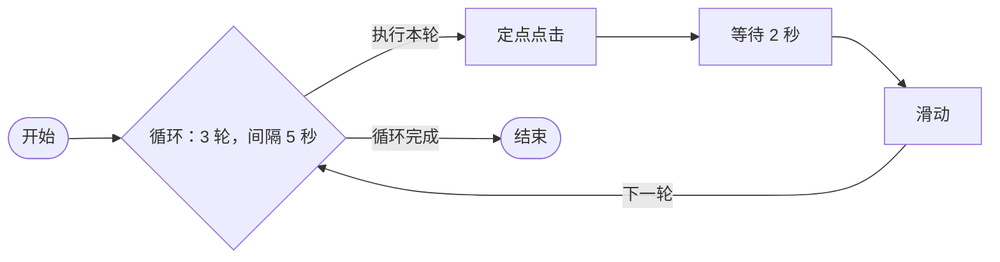
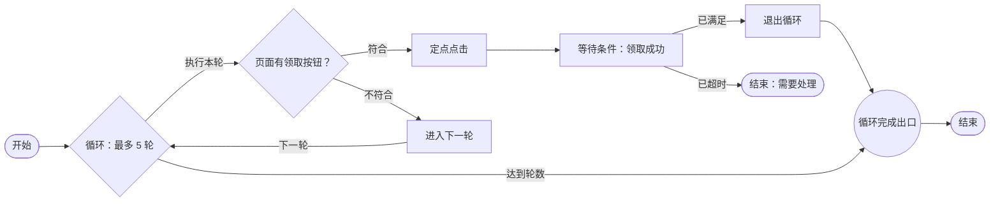
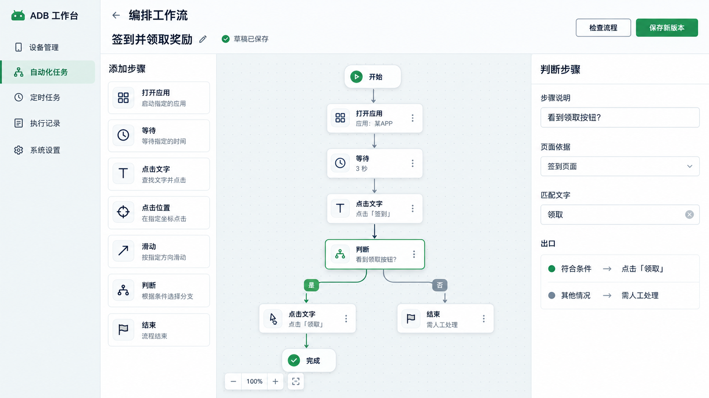
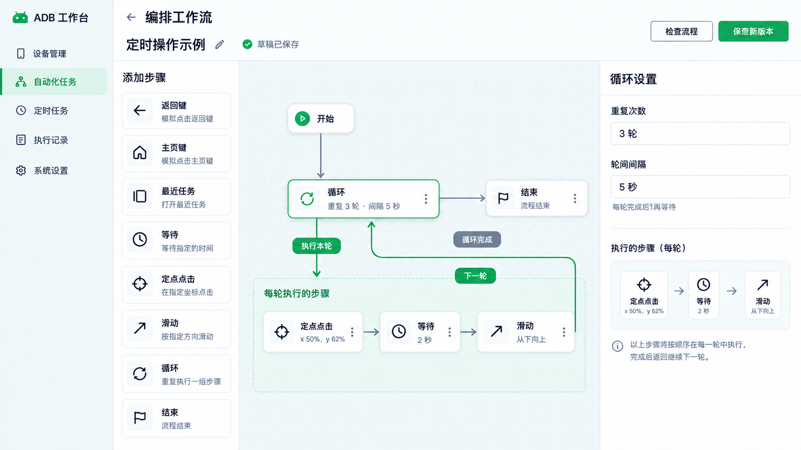

# 人工编排工作流开发方案

状态：人工编排首版已实现并完成自测，用户已同意按验收通过提交与推送。更新日期：2026-10-26。

当前入口：自动化任务 → 编排工作流，网址 `/editor`。支持全部下列节点、拖动与连线、连接去向选择、撤销／重做、自动排版、草稿切换与副本。草稿自动保存到后台；并发编辑会提示冲突，保存失败保留页面内容和浏览器恢复副本。点击和滑动可在手机截图上标注，文字条件可按手机框选识别区域；保存新版本前检查连线、循环范围和坐标参数；样本诊断可选，保存后直接运行。“运行”会自动保存当前修改。运行面板显示当前步骤和最近记录，支持暂停、继续及停止。

已保存任务从任务卡片继续编辑、归档与恢复的行为见 [已保存任务的编辑与归档](workflow-edit-archive.md)。

刷新或重新打开草稿会找回最新版本和最近的运行记录；暂停中的任务可在原记录上继续。循环、点击和滑动设置显示整个工作流的手机操作次数上限，分支按保守上限计数。

编辑顶栏固定单行、高 64px（不超过 70px）。工作流名称直接编辑；运行设置、草稿管理与错误详情按需弹出，不占画布高度。窄窗口将次要操作收进“更多”。

## 目标

在 ADB 工作台网页中，由人直接添加步骤、拖动节点、连接执行顺序、设置参数，再保存和运行。不要求手写工作流 JSON。执行仍由现有后台负责，继续使用设备身份核对、同机任务互斥、版本校验和恢复检查。

本方案以[现有工作流格式](workflows.md)为执行依据。原始演示文件位于本机 `/Users/cocko/WorkBuddy/2026-10-17-23-35-30/outputs/adb-automation-demo.html`：它已能添加、拖动、连线及编辑部分参数，但保存按钮无功能，运行只播放模拟日志。可借鉴界面和操作方式，不能把演示运行当作真实执行。

## 首批节点

| 画布上的名称 | 人可以设置什么 | 执行含义 |
| --- | --- | --- |
| 返回键、主页键、最近任务 | 按键种类 | 三个易找的入口，后台可共用一种按键步骤 |
| 等待 | 秒数 | 等待后进入下一步 |
| 定点点击 | 位置、次数、两次点击的间隔 | 在当前屏幕的指定位置点击 |
| 滑动 | 起点、终点、单次滑动时长、次数、两次滑动的间隔 | 按指定路线滑动 |
| 循环 | 重复轮数、两轮之间的间隔 | 重复执行一组相连步骤 |
| 条件判断 | 判断条件、全部／任一满足 | 根据结果走“符合”或“不符合”出口 |
| 等待条件 | 判断条件、检查间隔、最长等待时间 | 等条件成立再继续；超时走单独出口 |
| 退出循环 | 所属循环，由画布自动关联 | 提前结束当前循环，走该循环的完成出口 |
| 进入下一轮 | 所属循环，由画布自动关联 | 跳过本轮剩余步骤，进入下一轮 |
| 结束 | 完成或需要处理 | 明确结束流程 |

“开始”是画布上的入口标记，对应工作流的 `entry`，不增加一次手机操作。按键在画布中分开显示，减少选择成本。旧工作流的“确认键”继续兼容，不作为首批节点库入口。

点击、滑动节点的“次数”只重复该动作；循环节点重复其中的整组动作。间隔指两次动作或两轮之间的等待。方案默认第一次立即执行；若要先等待，放一个“等待”节点。这与现有定时滑动任务“先等一个间隔再滑动”的行为不同，新节点不能悄悄改变旧版本。

## 组合循环怎么画

一个循环节点有两个出口：“执行本轮”和“循环完成”。本轮最后一个步骤连回循环节点；达到设定轮数后，走完成出口。第一版支持固定轮数、单入口的循环体，循环体允许条件分支；不开放无限循环和嵌套循环。

没有提前退出或跳过时，“3 轮”表示点击、等待、滑动各执行 3 次。编辑器应显示动作次数上限，尤其是循环内的点击或滑动节点本身也设置了重复次数时；有条件分支时，不能把上限显示为必定执行的次数。流程检查要发现没有回线、没有完成出口、入口不通、缺少结束节点，以及超过执行步数上限的组合。

“退出循环”立即走循环完成出口，不再等待轮间间隔。“进入下一轮”将本轮计入已结束轮数，跳过剩余步骤；尚有下一轮时才等待轮间间隔。正常完成本轮也按同一规则计数。最后一轮之后直接走完成出口。循环内的“结束”节点结束整个任务。

后台要单独保存当前轮次和已结束轮数（含主动跳过的轮次）；现有运行进度只保存当前步骤的进度，进入下一步时会清空，不能直接拿来计整轮。轮数更新与下一步跳转需一起保存，避免重启后多算或少算一轮。暂停、断线或后台重启后，保留循环进度和当前步骤。结果未确认的点击、滑动不自动补做。

## 逻辑节点怎么用

### 条件判断

每次进入节点时读取当前画面或运行状态，再走“符合”或“不符合”出口。例如：“当前页面有‘领取’文字”时点击，没有时跳过。第一版使用两个出口；多个去向可串接判断节点。

条件按使用频率提供：

- **页面文字**：包含／不包含指定文字，可在截图上标注识别区域。
- **当前应用**：前台应用是／不是指定应用。
- **循环轮次**：当前是第几轮，支持等于、大于、小于。

同一判断可添加多条条件，选择“全部满足”或“任一满足”。第一版采用一层条件列表，不要求填写变量名、逻辑表达式或正则表达式。文字识别区域沿用各手机的坐标标注规则。

页面条件还需设置“页面依据”，例如先确认当前是任务页。只有页面已确认、识别成功时，才能得出“文字不存在”的结论；识别失败不能等同于文字不存在。单条条件结果无法确定时，停止并显示需要处理。组合条件采用同一规则：全部满足时，只要有一条已确认不符合即可走否定出口；任一满足时，只要有一条已确认符合即可走肯定出口；其余无法确定的组合停止处理。

### 等待条件

与固定等待分开显示。可使用上述页面文字、当前应用条件，设置检查间隔和最长等待时间。进入节点先检查一次，未满足时获取新画面继续检查；满足后走“已满足”，到时仍未满足则走“已超时”。例如等待“广告结束”文字出现，最多 40 秒，每 2 秒检查一次。

最长等待时间必须有限，检查间隔必须大于零。识别失败、陌生页面等异常不能伪装成超时；设备离线或锁屏沿用现有设备异常处理。暂停时间不计入有效等待，恢复后重新观察当前画面并保留已经等待的时长。此节点只观察，不自动重做之前的点击或滑动。

### 循环控制

“退出循环”和“进入下一轮”只在循环内可添加，由编辑器显示所属循环，不要求用户输入循环编号。循环内每条分支都要回到循环节点、进入循环控制节点，或结束整个任务；禁止直接连到循环外的普通节点。

图中的“循环完成出口”属于循环节点，并非另一个需要添加的节点。“进入下一轮”的回线由所属循环统一计数。画布应显示这些关联，校验时拒绝缺少所属循环的控制节点。

条件判断的多条分支可以连到同一个后续节点，按实际走到的那条分支继续，首版不增加独立的“汇合”节点。“全部／任一满足”属于条件设置，首版也不拆成 And／Or 节点。自动重试手机动作不纳入逻辑节点；结果未确认时继续沿用现有恢复检查。

## 不同手机的坐标

1. 在编辑器中选择目标手机，展示**该手机当前截图**。点击位置由点选截图得到；滑动起点和终点由在截图上标注得到，不要求手填像素。
2. 保存相对位置：`横向比例 = 截图中的 x ÷ 截图宽度`，`纵向比例 = 截图中的 y ÷ 截图高度`。执行前按当前实际屏幕尺寸换算，并保留标注时的截图尺寸和屏幕方向用于核对。
3. 同一工作流的每个坐标节点允许按手机分别标注。相同比例只解决分辨率缩放；按钮因长宽比、导航栏或应用排版而移动时，必须使用该手机自己的标注。新手机使用前先预览、确认位置。
4. 折叠屏外屏／内屏、横屏／竖屏视为不同屏幕形态。执行坐标动作前核对当前形态；缺少匹配标注或运行中形态改变时，停止该动作并提示重新标注，不猜测位置。

截图与 ADB 点击、滑动必须落在同一块实际显示屏。折叠屏的折叠／展开、荣耀、iQOO 以及画面旋转需分别实测。将来如按钮会随页面内容移动，再增加找字或找图定位；百分比坐标不能代替页面识别。

## 画布与保存

- 左侧节点库、中间画布、右侧所选节点的设置。画布支持拖动、连线、缩放；连线旁直接显示“执行本轮”“循环完成”等去向。参考下方效果图，但执行关系以上方流程图为准。
- 除拖线外，还要能通过“下一步”选择框建立连接；所有设置可用键盘操作，错误显示在对应节点旁。
- 先保存为**草稿**，允许中途离开、重新打开；草稿不会被定时任务或普通运行选用。建议草稿自动存入现有后台数据库，避免只保存在当前浏览器。
- 检查通过后，转换成现有工作流数据并保存为**新版本**，不覆盖历史版本。保存后直接运行；样本检查为可选诊断，不再有试跑或启用门槛。
- 画布上的连线应转换为现有 `next` 等跳转关系；不要另存一套与后台执行顺序可能冲突的“真实连线”。节点摆放位置可作为独立的画布布局保存，不因单纯拖动位置而增加执行版本。

正式版本应保存本版所用的坐标标注，按“步骤＋手机编号＋屏幕形态”查找。修改某台手机的标注要产生新版本，不能悄悄改变正在运行的旧版本；仅移动画布上的节点则不影响执行版本。现有设备设置只保存**一个**定点点击位置，无法承载多个节点的不同标注。

两张图片是讨论用效果图，不代表已开发页面；循环图片中的连线布局只表达视觉方向，准确的循环出口和回线以上方流程图为准。

## 复用与需要补齐的地方

- 前端继续使用 Svelte 工作台。画布使用 Svelte Flow，自动排版使用 Dagre，复用原 Demo 的布局和交互经验；不要直接接入 Demo 的模拟执行代码。
- 旧执行步骤保留等待、返回／主页、单次相对位置滑动、相对位置点击，以及固定像素的重复点击。新 `canvas` 步骤补充最近任务键及本方案中的动作和逻辑能力。
- 新编排步骤使用 `canvas` 执行类型，定义与执行位于 `src/canvas.rs`；草稿保存位于 `src/drafts.rs`。等待、暂停、同机互斥、身份核对、版本与运行继续复用现有后台。各步骤按节点编号显示运行位置，循环进度独立保存到运行记录。
- 首版人工条件使用本地文字识别、当前应用和循环轮次，文字条件仍沿用“先核对页面”的原则。制作文字条件需安装兼容的本地识别程序；旧纯视觉工作流继续使用原有 `vision_route` 与截图样本机制，首版画布不提供纯视觉判断配置。
- 旧定点点击继续使用固定像素，旧重复滑动继续使用预设路线；新 `canvas` 坐标步骤按设备和屏幕标注执行。运行版本中的坐标标注不可覆盖；单纯调整草稿布局，再次保存版本会复用相同的执行定义。
- 旧工作流格式和已保存版本继续可运行。新编辑器不能把 Demo 中尚无真实执行支持的独立 OCR、变量、通知、通用 For／While 节点展示为可运行节点。

## 最小验收单位

画布与草稿已由用户验收并提交。后续单元由 Agent 连续自测与修复；用户于 2026-10-26 同意按验收通过提交与推送。

以下单元均已实现，自动检查覆盖版本、动作次数、循环控制、条件超时、陌生页面、尺寸变化、输入失败及暂停重启恢复。真机机型和折叠／旋转的实际页面不在模拟回放范围内；多屏手机无法解析触控显示编号时会拒绝标注，需根据该机的实际显示信息补充适配。

1. **画布与草稿（用户验收通过，2026-10-26）**：添加、删除、拖动、连线、修改参数；刷新网页后草稿仍在。此时不操作真机。自动检查使用 `python3 scripts/check-editor.py`，验证身份检查、并发冲突、后台重启保留，以及草稿不参与执行。
2. **按键与等待（自测通过）**：保存新版本，检查流程，用隔离模拟设备验证三种导航键和等待；界面提供直接运行。
3. **定点点击与滑动（自测通过）**：已用两台模拟手机和两种尺寸验证独立标注、次数、间隔、屏幕切换与错误提示；iQOO、荣耀的真实页面需按各自截图标注。
4. **组合循环（自测通过）**：验证整组动作恰好执行指定轮数；测试停止、暂停、断线和后台重启后进度正确，不补做未确认动作。
5. **条件判断（自测通过）**：验证符合、不符合与无法确定三种结果；测试全部／任一满足、各手机的识别区域、应用与轮次条件，并提供判断样本。
6. **等待条件（自测通过）**：验证首次检查、满足、超时，以及暂停后继续计时；确认陌生页面、识别失败和设备异常不会走普通超时出口。
7. **循环控制（自测通过）**：验证提前退出、跳过本轮、最后一轮跳过、分支汇合和中途恢复；确认跳转时不会重复计数，也不会越过循环上限。

按键与等待的试用流程：返回键 → 等待 3 秒 → 主页键 → 等待 3 秒 → 最近任务 → 结束。在隔离预览选择“模拟手机”，保存新版本后运行；等待时暂停再继续，检查步骤高亮与执行记录。自动检查核对三种按键各执行一次、顺序正确、暂停期间不计等待时间，以及首次直接运行。

现有网页修改需运行 `npm run check` 与构建；执行行为修改需运行 `cargo test` 和隔离模拟设备集成检查。真机试跑由用户选择页面与设备后进行。

自测范围与复查命令见 [编排器自测记录](visual-workflow-editor-testing.md)。
